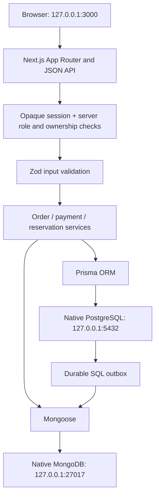

# Architecture

There is no separate Express backend, cloud database, hosted authentication, container, or inter-laptop communication. Browser assets, images and fonts are local. Both native database services authenticate connections and bind to IPv4 loopback. Project-owned data directories are isolated under `.data`; runtime credentials are generated into `.env`.

## Responsibilities

PostgreSQL owns customers, staff, menu categories and dishes, physical tables, bookings, orders, historical line prices and payments. Nine core tables are supplemented by session, login_attempt and outbox support tables. Foreign keys and constraints enforce relationships. Prisma migrations contain PostgreSQL-specific generated columns, exclusion constraints and trigger functions; Prisma schema alone is not a replacement for these migrations.

MongoDB owns three document collections: reviews (nested per-dish ratings), customer_preferences (flexible dietary/cuisine/allergen lists), and order_customizations (nested line instructions). Unique indexes enforce one review per order, one preference document per customer, and one customization document per order line. SQL identifiers are validated on server-side writes. No foreign key can cross database engines.

## Request boundaries

All mutating requests require JSON, the configured same-origin Origin header, Zod validation and server-side authentication/authorization. Registration cannot supply roles or IDs. Customer identities come from the session, not the browser. Customer order and reservation reads/writes check ownership; manager endpoints check the Manager role. Chef, Waiter and Cashier permissions apply independently on the server.

Passwords use Node scrypt with random salts; constant-time comparisons verify hashes. A random 256-bit session token is placed in an HttpOnly, SameSite=Strict cookie for eight hours. PostgreSQL stores its HMAC digest and expiry. HTTPS deployments would use Secure cookies; the requested loopback HTTP server cannot use Secure cookies. Sessions read staff role and active state on every request. A SQL atomic counter limits normalized-email sign-in attempts to ten per fifteen-minute window.

## Orders and payments

An order transaction reads available menu records, creates the parent order, inserts distinct lines with current SQL prices, and writes a durable customization outbox record. The browser's amount is rejected. Quantities are limited. Generated subtotals and an atomic delta trigger maintain totals; parent order row locks serialize line writes and payments. Historical prices and line identities cannot be updated. Paid and closed bills cannot have quantities changed.

Checkout carries a unique UUID idempotency key. Replaying an already committed token returns that customer's order; a concurrent duplicate can return a conflict and can safely be retried. This does not coordinate different checkout tokens or different laptops.

Payments lock the parent order, use its stored total, and enforce UNIQUE(order_id). A verification trigger rejects mismatched, empty or cancelled bills and mutation of a completed payment. Only valid order transitions are accepted. Closing an order requires a served state and completed payment. There is no real payment processor.

## SQL/MongoDB partial failures

There is no cross-engine transaction. Every order and its customization payload commit atomically to SQL first. After commit, the service upserts MongoDB documents by unique order_item_id, then marks the outbox processed. A failed MongoDB write leaves SQL instructions intact and returns an explicit pending flag. Kitchen details fall back to that payload during an outage. Reviews and preferences report service errors instead of pretending to save.

Retries occur on order list/detail reads, `npm run db:reconcile`, and the administrator retry button. There is no independent background worker; synchronization resumes when one of these operations runs. Replays are idempotent. An order could commit while its HTTP response is lost; reusing the browser's stored checkout key avoids creating another order. Cross-database deletion is handled for disposable test records; customer account deletion is not exposed, avoiding orphaned user documents.

## Reservation concurrency

Reservation date/time remain original civil-time columns. Generated starts_at and ends_at add duration semantics. The trigger validates table capacity and gives an early conflict error while locking the parent table. A partial GiST exclusion constraint on `(table_id, tsrange(starts_at,ends_at,'[)'))` where status=Confirmed provides the final concurrency-safe overlap invariant. Half-open intervals allow adjacent bookings. The application checks future dates and opening hours (11:00–23:00 IST); PostgreSQL protects capacity and overlap even for direct writes.
