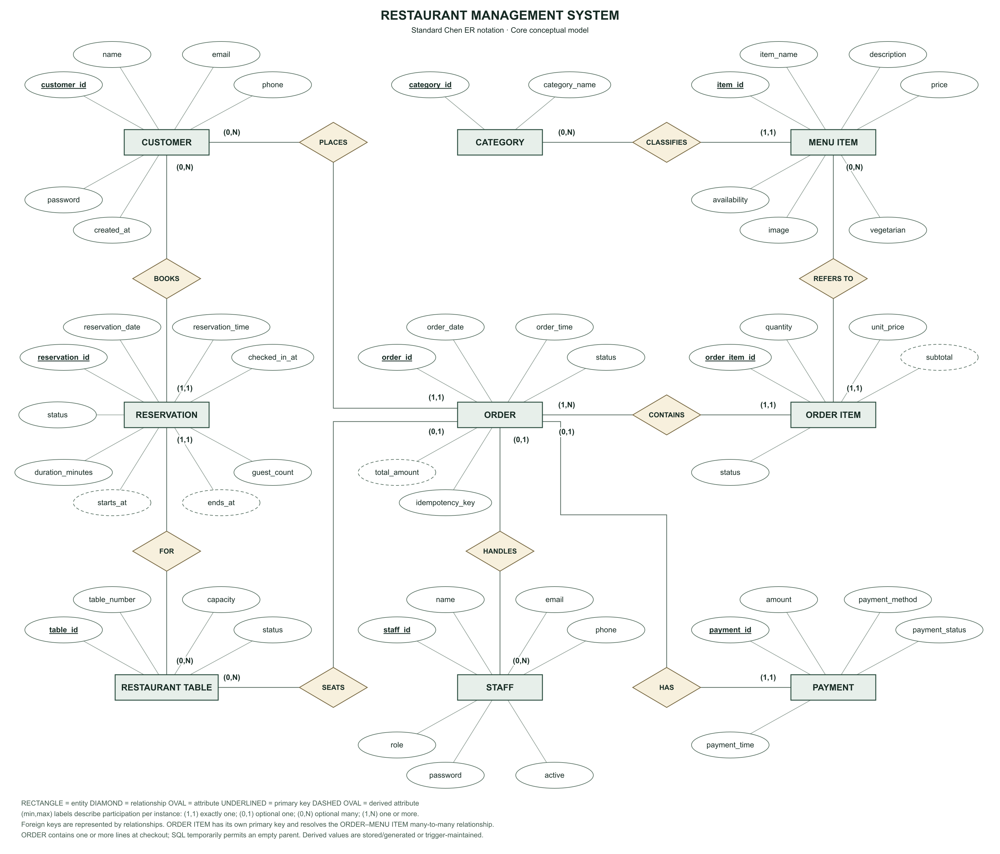
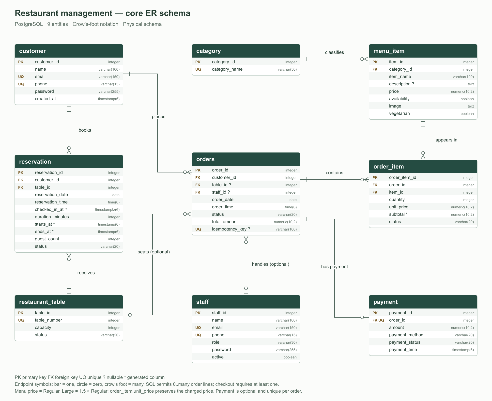
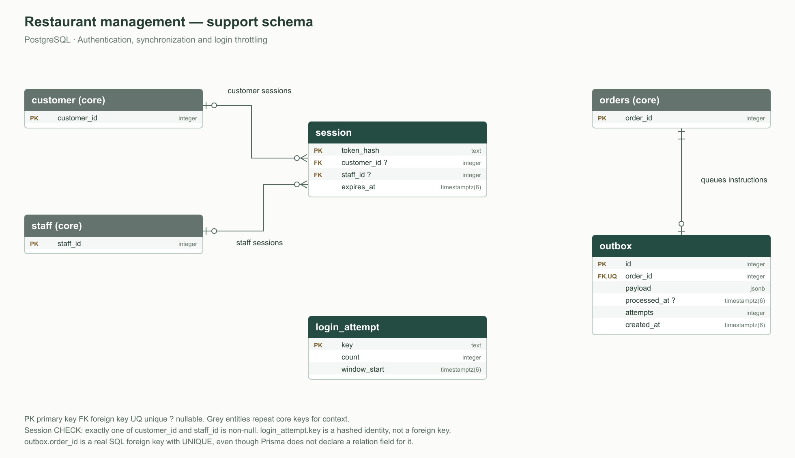
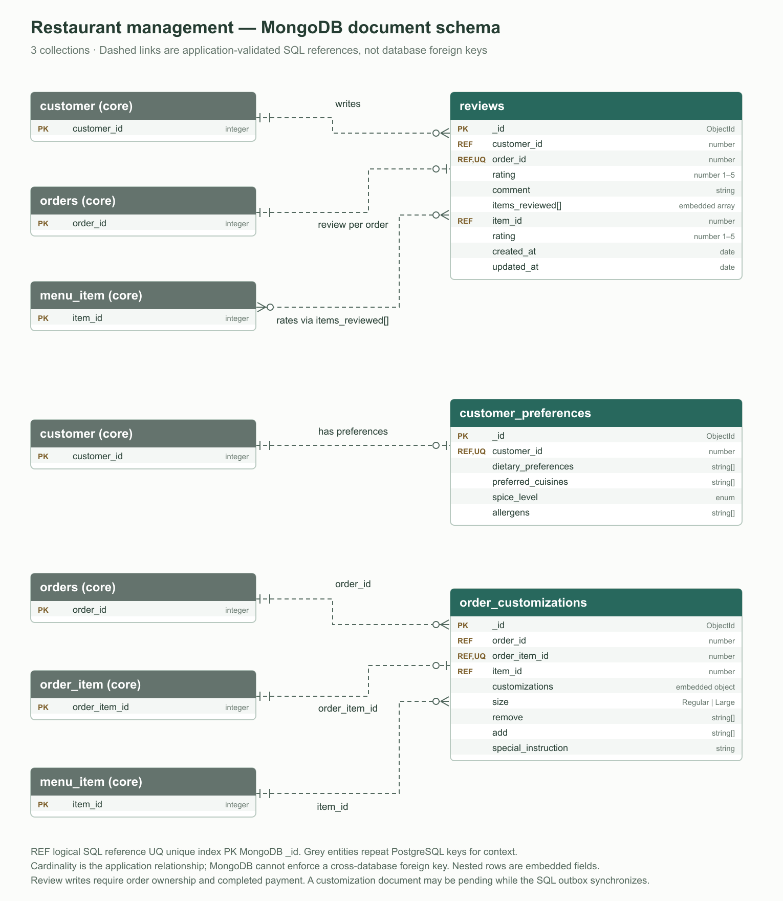

# Restaurant management — entity–relationship schema

The diagrams describe the current implementation: **9 core PostgreSQL tables, 3 support tables, and 3 MongoDB collections**. PostgreSQL attributes are generated from `prisma/schema.prisma`, with foreign keys checked against the SQL migrations. MongoDB fields match the Mongoose models. Migration bookkeeping is omitted.

## Standard ER diagram — Chen notation



[Scalable SVG](diagrams/restaurant-standard-chen-er.svg) · [High-resolution PNG](diagrams/restaurant-standard-chen-er.png) · [Editable generator](../scripts/render-chen-er.mjs) · [Entity/attribute data](diagrams/restaurant-standard-chen-er.json)

This standard conceptual diagram shows the **nine main entities**, **nine relationships**, and **51 attributes**. Rectangles are entities, diamonds are relationships, and ovals are attributes. Primary keys are underlined. Derived attributes use dashed ovals: line subtotal, order total, and reservation boundaries. These derived values are physically stored/generated or maintained by a trigger in the implementation.

Labels use **(minimum, maximum) participation per entity instance**. For example, Customer (0,N) — PLACES — Order (1,1) means a customer can place zero or many orders, while each order belongs to exactly one customer. Optional table and staff assignments use (0,1) on the Order side; an order may have zero or one payment. The conceptual Order–Order_Item relationship requires at least one line at checkout; SQL permits a temporary empty parent during construction.

Foreign keys are represented by relationship connectors rather than repeated as conceptual attributes. Order_Item has its own primary key, so it is drawn as a regular entity, not a weak entity. `ORDER` and `RESTAURANT TABLE` are conceptual labels for the physical `orders` and `restaurant_table` tables. Password attributes hold scrypt hashes. Optional attributes and alternate unique constraints are detailed in the physical schema below.

Application support tables and MongoDB collections remain in the separate diagrams below so the main academic ER diagram stays readable.

## 1. Core PostgreSQL schema — physical crow’s-foot notation



[Scalable SVG](diagrams/restaurant-core-er.svg) · [PNG image](diagrams/restaurant-core-er.png) · [Editable Mermaid](diagrams/restaurant-core-er.mmd)

| Parent | Child | Relationship |
| --- | --- | --- |
| Customer | Reservation | One customer → zero or many reservations; each reservation has one customer. |
| Restaurant_Table | Reservation | One table → zero or many reservations over time; each reservation has one table. |
| Customer | Orders | One customer → zero or many orders; each order has one customer. |
| Restaurant_Table | Orders | One table → zero or many orders; each order has zero or one table (takeaway has none). |
| Staff | Orders | One staff member → zero or many assigned orders; each order has zero or one assigned staff member. |
| Category | Menu_Item | One category → zero or many dishes; each dish belongs to one category. |
| Orders | Order_Item | One order → zero or many rows at SQL level; each line belongs to one order. Checkout requires at least one line. |
| Menu_Item | Order_Item | One dish → zero or many order lines; each line refers to one dish. |
| Orders | Payment | One order → zero or one payment; each payment belongs to one order. |

`Order_Item` resolves the many-to-many relationship between orders and dishes. Its surrogate primary key permits multiple independently customized lines for the same dish in the same order. `Payment.order_id` is both a foreign key and unique, enforcing at most one payment per order.

## 2. PostgreSQL support schema



[Scalable SVG](diagrams/restaurant-support-er.svg) · [PNG image](diagrams/restaurant-support-er.png) · [Editable Mermaid](diagrams/restaurant-support-er.mmd)

- A customer or staff member can have zero or many sessions. Each session belongs to exactly one customer **or** one staff member, enforced by a SQL CHECK constraint.
- An order has zero or one outbox row, enforced by the unique foreign key `outbox.order_id`. The outbox holds kitchen instructions until MongoDB synchronization succeeds.
- Login_Attempt is independent. Its primary key is a hashed login identity, not a foreign key to Customer or Staff.
- Grey boxes repeat core primary keys for context; they are not additional tables.

## 3. MongoDB document schema and SQL references



[Scalable SVG](diagrams/restaurant-mongodb-er.svg) · [PNG image](diagrams/restaurant-mongodb-er.png) · [Editable Mermaid](diagrams/restaurant-mongodb-er.mmd)

Dashed connectors represent application-validated references across database engines. They are **not SQL foreign keys**. Each collection also has MongoDB's `_id` primary identifier. Nested rows are embedded fields, not extra collections; automatic Mongoose version metadata is omitted.

- **Reviews:** a customer can write many reviews; an order can have at most one review because `order_id` has a unique index. A review may rate multiple dishes through `items_reviewed[]`, and a dish may appear in multiple reviews. Each array element contains an `item_id` reference and a rating. Review writes require ownership, completed payment, and dishes belonging to that order.
- **Customer_Preferences:** a customer can have zero or one preferences document, enforced by a unique `customer_id` index.
- **Order_Customizations:** an order can have multiple customization documents, one per order line. `order_item_id` is unique. Each document also references its order and menu item. A document may be temporarily absent while the SQL outbox is pending.
- `customizations` contains `size`, `remove[]`, `add[]`, and `special_instruction`. Extra-cheese and crust fields are no longer offered.

## Notation and derived values

- **PK:** primary key. **FK:** SQL foreign key. **UQ:** unique constraint/index. **REF:** logical cross-database reference.
- **?** means nullable; other SQL attributes are required. MongoDB requiredness is defined by its Mongoose schema and API validation.
- Crow's-foot endpoints: a bar means one, a circle means zero, and a fork means many. Combinations express exactly one, zero or one, and zero or many.
- **\*** marks a generated SQL column: `subtotal = quantity × unit_price`, and reservation boundaries derive from date, time, and duration.
- `Orders.total_amount` is maintained by the order-total trigger. Regular prices come from Menu_Item; Large portions cost 50% more, rounded to paise, and the charged unit price is stored in Order_Item.
- Confirmed reservation ranges cannot overlap for the same table. Adjacent time slots are permitted. `checked_in_at` records staff assignment.
- `Orders.staff_id` is an optional stored association; staff authorization comes from the authenticated role, not from this association.

## Regenerate

Run from the project root with Node 24 and installed dependencies:

```sh
node scripts/render-er-diagrams.mjs
node scripts/render-chen-er.mjs
```

The first command rebuilds the physical SVG, PNG, and Mermaid diagrams. The second rebuilds the standard Chen SVG/PNG and its entity/attribute JSON in `docs/diagrams/`. The original submission remains preserved in `docs/reference/`.
