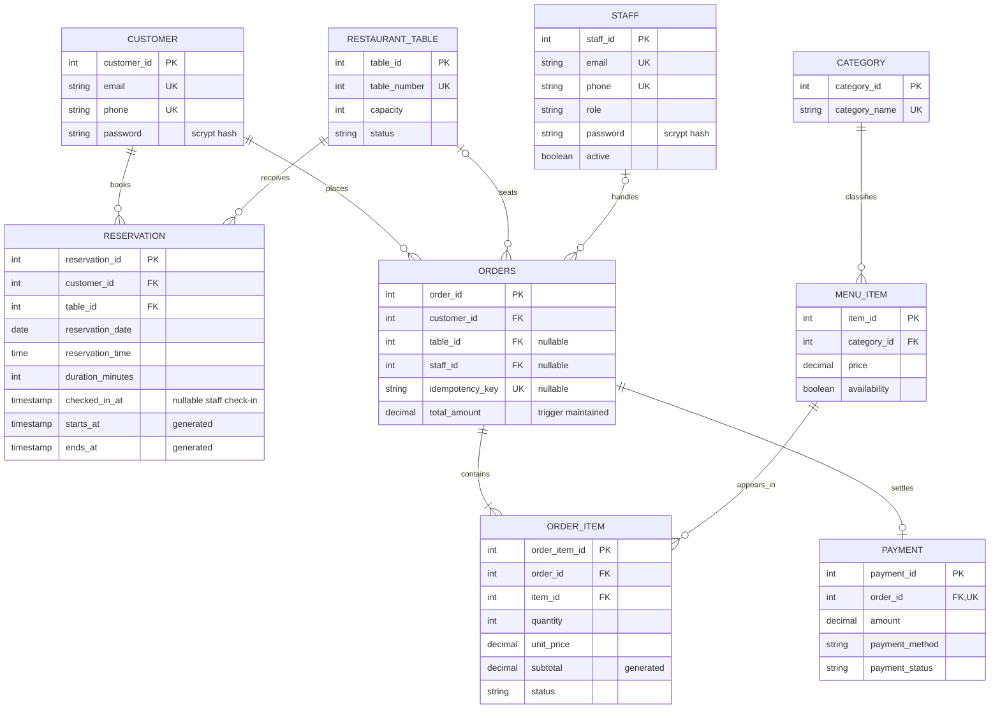
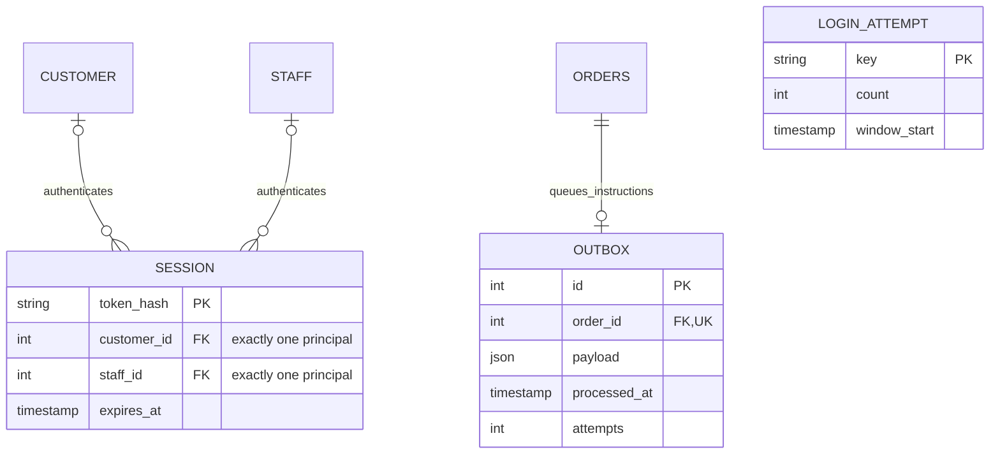

# Final ER diagram

Core relationships from the submission are unchanged. Order_Item now has a surrogate line key so multiple customized versions of a dish can belong to the same order.

An order has one or more lines at the service-transaction boundary. SQL allows a temporary empty parent while the transaction inserts its lines; payment rejects an empty bill. At most one payment record exists for an order.

Support relationships:

MongoDB uses validated logical references: reviews.customer_id/order_id and items_reviewed.item_id; order_customizations.order_id/order_item_id/item_id; customer_preferences.customer_id. They are not SQL foreign keys. The original graphical submission is preserved in reference/original-submission.pdf and reference/er-03.png.
